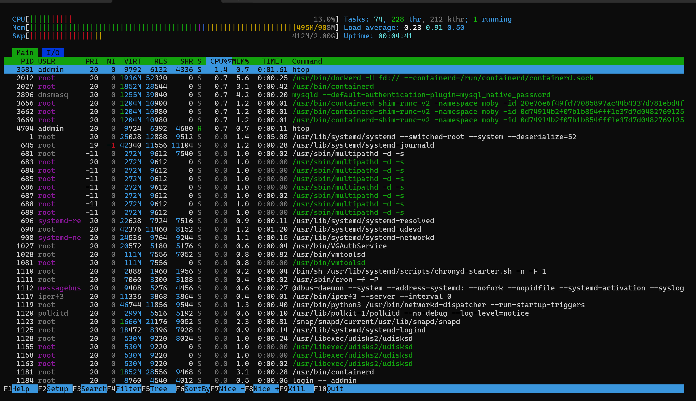
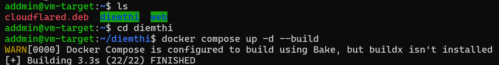
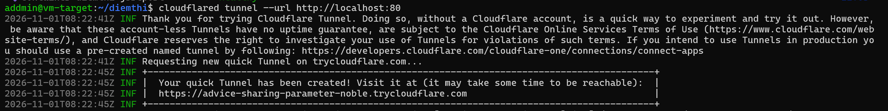
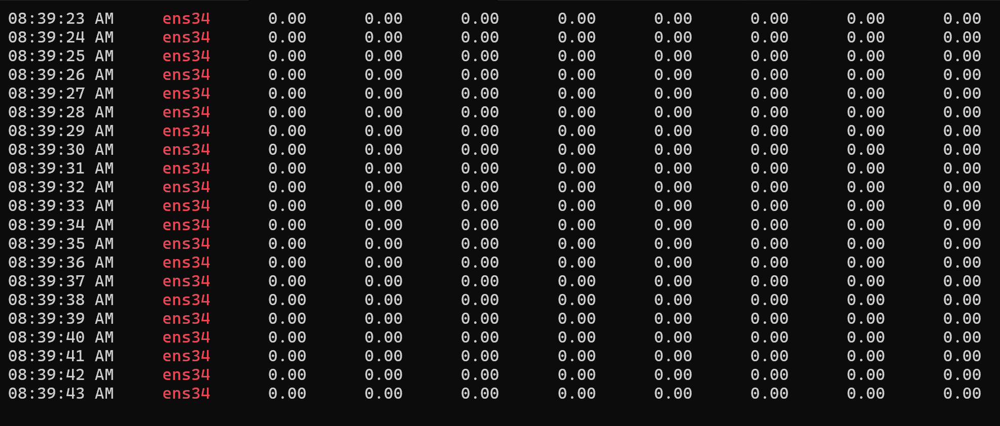
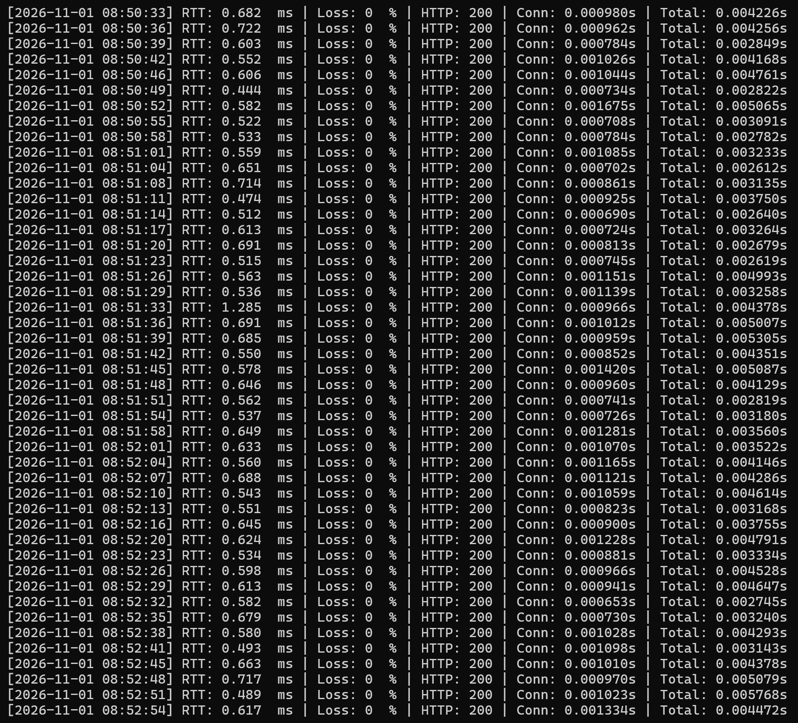
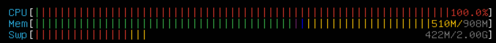
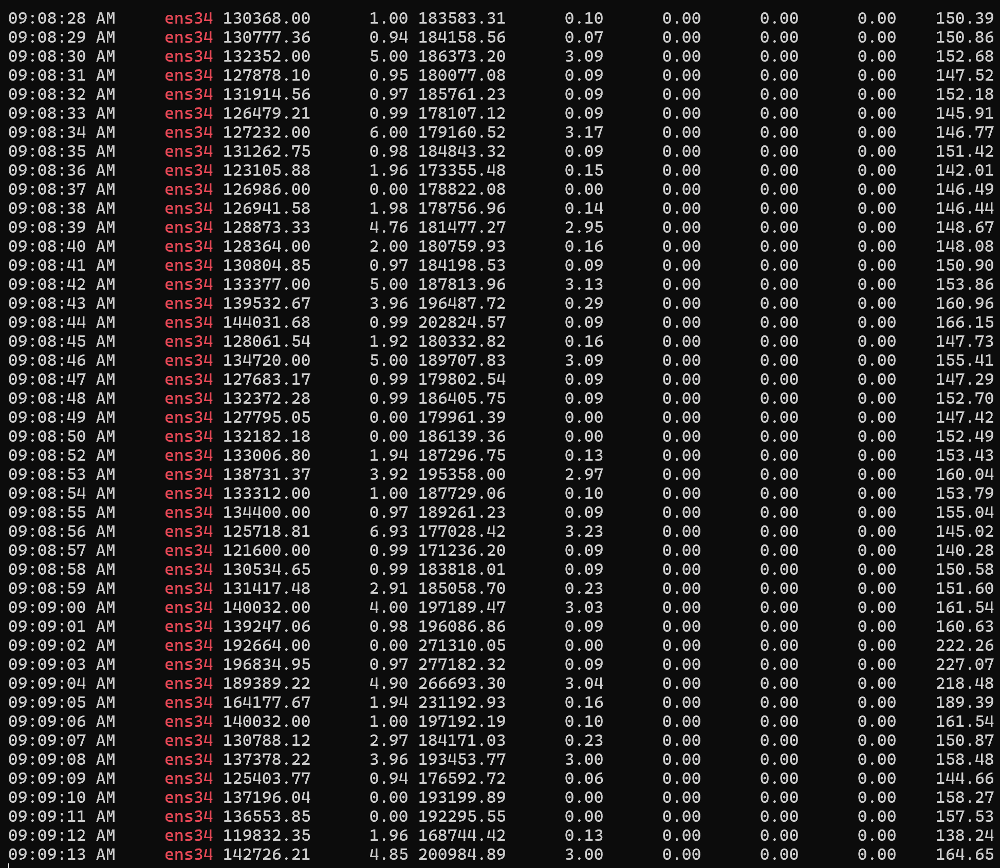
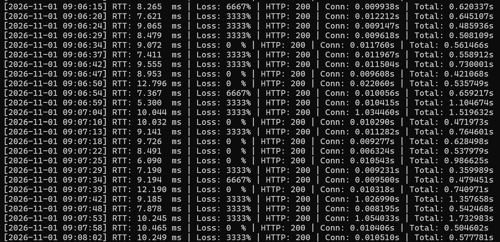

# MÔ PHỎNG VÀ ĐO ĐẠC TẤN CÔNG DDoS ( UDP FLOOD)

---

## MỤC LỤC

1. [Khái Niệm DDoS](#1-khái-niệm-ddos)
2. [Hai Loại Tấn Công](#2-hai-loại-tấn-công)
   - 2.1. Smurf Attack
   - 2.2. UDP Flood
3. [Cấu Trúc Lab](#3-cấu-trúc-lab)
4. [Cách Tấn Công](#4-cách-tấn-công)
5. [Cách Đo Đạc](#5-cách-đo-đạc)

---

## 1. Khái Niệm DDoS

**DDoS (Distributed Denial of Service — Tấn công từ chối dịch vụ phân tán)** là hình thức tấn công mạng trong đó kẻ tấn công sử dụng nhiều nguồn (máy tính, botnet, hoặc kỹ thuật phản xạ/khuếch đại) để gửi một lượng cực lớn gói tin đến máy chủ mục tiêu, nhằm làm cạn kiệt tài nguyên hệ thống (băng thông, CPU, bộ nhớ, hàng đợi kết nối) khiến máy chủ không thể phục vụ các yêu cầu hợp lệ từ người dùng thật.

**Đặc điểm chính:**

- Tấn công đến từ nhiều nguồn khác nhau đồng thời, gây khó khăn trong việc phân biệt lưu lượng hợp lệ và lưu lượng tấn công.
- Kẻ tấn công thường sử dụng kỹ thuật **giả mạo IP nguồn (IP Spoofing)** để che giấu danh tính và khuếch đại hiệu quả tấn công.
- Mục tiêu cuối cùng là làm gián đoạn hoặc ngừng hoàn toàn dịch vụ của nạn nhân (Denial of Service).

**Phân loại theo bản chất:**

| Loại tấn công | Bản chất | Ví dụ |
|:---|:---|:---|
| **Bão hòa băng thông (Volumetric)** | Gửi lượng dữ liệu cực lớn làm nghẽn đường truyền vật lý | UDP Flood, Smurf Attack |
| **Cạn kiệt tài nguyên trạng thái (State Exhaustion)** | Khai thác cấu trúc giao thức để làm tràn hàng đợi, bộ nhớ kernel | TCP SYN Flood, IP Fragmentation |
| **Phản xạ khuếch đại (Reflection/Amplification)** | Lợi dụng dịch vụ trung gian để nhân bội lưu lượng dội về nạn nhân | Smurf Attack, DRDoS DNS |

---

## 2. Phương pháp tấn công


### 2.1. UDP Flood

**Nguyên lý hoạt động:**

UDP Flood khai thác tính chất **phi trạng thái (connectionless/stateless)** của giao thức UDP để bơm một lượng cực lớn dữ liệu vào đường truyền, nhằm bão hòa hoàn toàn băng thông vật lý của card mạng nạn nhân.

**Cơ chế chi tiết:**

1. Kẻ tấn công sử dụng công cụ chuyên dụng gửi hàng loạt gói tin **UDP** với tốc độ tối đa, payload lớn sát trần MTU ($1400\text{ bytes}$, cộng $8\text{ bytes}$ UDP header và $20\text{ bytes}$ IP header = $1428\text{ bytes}$ — nằm trọn dưới MTU chuẩn $1500\text{ bytes}$) tránh bị phân mảnh để đạt tốc độ wire-speed cao nhất.
2. UDP không có cơ chế bắt tay 3 bước (three-way handshake), không kiểm soát luồng (flow control), không kiểm soát tắc nghẽn (congestion control). Khi mạng bị nghẽn, UDP **không hề giảm tốc** mà tiếp tục bơm dữ liệu vào đường truyền với công suất tối đa.
3. Khi lưu lượng gửi đến vượt quá khả năng xử lý của card mạng, hàng đợi bộ đệm nhận (**RX Ring Buffer**) bị lấp đầy hoàn toàn.
4. Hiện tượng **Tail Drop** xảy ra: Mọi gói tin đến sau (bao gồm cả gói ping ICMP và gói HTTP của Client hợp lệ) đều bị vứt bỏ ngay tại tầng vật lý.

**Hiện tượng khi bị tấn công:**

- Client bị mất gói (Loss $30\% - 70\%$), Ping RTT tăng vọt lên hàng trăm miligiây.
- Trang web Nginx bị timeout nghẽn.
- CPU Target tăng cao do nhân Linux phải xử lý ngắt mềm SoftIRQ (`ksoftirqd`) liên tục cho mỗi gói tin nhận vào.

```
Kẻ tấn công (Attacker)                                   Nạn nhân (Target)
192.168.100.20                                            192.168.100.10
     |                                                         |
     |=== UDP payload 1400 bytes (thread 1) ==================>|
     |=== UDP payload 1400 bytes (thread 2) ==================>|  RX Ring Buffer
     |=== UDP payload 1400 bytes (thread 3) ==================>|  bị lấp đầy!
     |=== UDP payload 1400 bytes (thread 4) ==================>|
     |         ... hàng trăm nghìn gói/giây ...                |
     |                                                         |
     |                                          Gói tin Client |
     |                              hợp lệ ---> [BỊ DROP]     |
```


---

## 3. Cấu Trúc Lab

### 3.1. Tổng quan kiến trúc

Hệ thống thực nghiệm gồm **3 máy ảo** trên nền tảng **VMware Workstation Pro/Player**, kết nối qua hai mặt phẳng mạng:

- **Mặt phẳng quản trị (Management Plane — Card 1 NAT):** Cung cấp Internet để cài đặt phần mềm (`apt-get update/install`).
- **Mặt phẳng dữ liệu thực nghiệm (Data Plane — Card 2 LAN Segment `ddos-lab`):** Mạng cô lập hoàn toàn, nơi diễn ra toàn bộ kịch bản tấn công và đo đạc. Lưu lượng tấn công không bao giờ thoát ra ngoài mạng gia đình/trường học.

**Tại sao dùng LAN Segment thay vì NAT hoặc Bridged?**

- Chế độ **Bridged**: Gói tin tấn công (đặc biệt IP Spoofing từ `hping3`) sẽ thoát thẳng ra card mạng vật lý, có thể làm treo Router gia đình hoặc bị ISP khóa cổng.
- Chế độ **NAT (VMnet8)**: Bảng trạng thái NAT Connection Tracking trên Host sẽ bị tràn và treo cứng máy thật.
- **LAN Segment**: Switch Layer 2 ảo cô lập 100%, cho phép truyền tải nguyên vẹn gói tin giả mạo IP, gói broadcast mà không ảnh hưởng máy thật.

### 3.2. Sơ đồ mạng

```
┌──────────────────────────────────────────────────────────────────────┐
│                    Máy tính vật lý (Host Windows)                    │
│                                                                      │
│  ┌────────────────────────────────────────────────────────────────┐  │
│  │      VMware Virtual Switch — LAN Segment: "ddos-lab"           │  │
│  │                  Subnet: 192.168.100.0/24                      │  │
│  │                                                                │  │
│  │  ┌──────────────────┐  ┌──────────────────┐  ┌──────────────┐ │  │
│  │  │ [MÁY 1] Target   │  │ [MÁY 2] Attacker │  │ [MÁY 3]      │ │  │
│  │  │ Ubuntu Server    │  │ Kali Linux       │  │ Client       │ │  │
│  │  │ 22.04 LTS        │  │                  │  │ Ubuntu Server│ │  │
│  │  │                  │  │                  │  │ 22.04 LTS    │ │  │
│  │  │ Card 1: NAT/DHCP │  │ Card 1: NAT/DHCP │  │ Card 1: NAT │ │  │
│  │  │ Card 2 (ens34):  │  │ Card 2 (eth1):   │  │ Card 2:      │ │  │
│  │  │ 192.168.100.10   │  │ 192.168.100.20   │  │ 192.168.100. │ │  │
│  │  │                  │  │                  │  │ 30           │ │  │
│  │  │ Services:        │  │ Tools:           │  │ Tools:       │ │  │
│  │  │ Nginx (:80)      │  │ hping3, iperf3   │  │ curl, ping   │ │  │
│  │  │ iperf3 (:5201)   │  │ tcpdump          │  │ script đo đạc│ │  │
│  │  │ Docker Web (:8080│  │                  │  │              │ │  │
│  │  │ CF Tunnel→domain │  │                  │  │              │ │  │
│  │  └──────────────────┘  └──────────────────┘  └──────────────┘ │  │
│  │           ▲                     │                    │         │  │
│  │           │    Luồng Flood      │   Đo RTT & HTTP    │         │  │
│  │           └─────────────────────┘────────────────────┘         │  │
│  └────────────────────────────────────────────────────────────────┘  │
└──────────────────────────────────────────────────────────────────────┘
```

### 3.3. Bảng thông số kỹ thuật chi tiết

| Thông số | Máy 1: VM-Target | Máy 2: VM-Attacker | Máy 3: VM-Client |
|:---|:---|:---|:---|
| **Vai trò** | Máy chủ Web & Mục tiêu tấn công | Máy phát động tấn công | Người dùng hợp lệ & Thu thập số liệu |
| **Hệ điều hành** | Ubuntu Server 22.04 LTS | Kali Linux | Ubuntu Server 22.04 LTS |
| **Hostname** | `vm-target` | `vm-attacker` | `vm-client` |
| **vCPU** | 2 Cores | 2 Cores | 1 Core |
| **RAM** | 1024 MB (1 GB) | 2048 MB (2 GB) | 1024 MB (1 GB) |
| **Dung lượng ổ đĩa** | 25 GB | 25 GB | 20 GB |
| **Network Adapter 1** | NAT (DHCP) | NAT (DHCP) | NAT (DHCP) |
| **Network Adapter 2** | LAN Segment: `ddos-lab` | LAN Segment: `ddos-lab` | LAN Segment: `ddos-lab` |
| **Tên interface LAN** | `ens34` | `eth1` (hoặc `ens34`) | `ens34` |
| **IP thực nghiệm** | **`192.168.100.10/24`** | **`192.168.100.20/24`** | **`192.168.100.30/24`** |
| **Trình quản lý mạng** | Netplan (`systemd-networkd`) | NetworkManager (`nmcli`) | Netplan (`systemd-networkd`) |

### 3.4. Dịch vụ Web trên VM-Target (Docker + Cloudflare Tunnel)

Trên máy VM-Target, ngoài Nginx và iperf3 phục vụ đo đạc, một **trang web bán hàng thực tế** được triển khai bằng Docker để làm mục tiêu tấn công có ý nghĩa thực tiễn hơn.

#### Kiến trúc ứng dụng Web

Ứng dụng **Modern Shop** là trang bán hàng điện tử (Điện Thoại, Laptop, Phụ Kiện) được xây dựng bằng **PHP 8.2 + Apache + MySQL 8.0**, chạy hoàn toàn trong Docker containers:

```
┌─────────────────────────────────────┐
│   VM-Target (192.168.100.10)        │
│                                     │
│  ┌──────────────────────────────┐   │
│  │         Docker               │   │
│  │  ┌─────────────────┐         │   │
│  │  │      Web        │         │   |
│  │  └─────────────────┘         |   | 
│  └──────────────────────────────┘   │
│               │                     │
│           Port 8080                 │
│               │                     │
│    ┌──────────▼──────────┐          │
│    │  Cloudflare Tunnel  │          │
│    │  (cloudflared)      │          │
│    │  NAT → Internet     │          │
│    └─────────────────────┘          │
│                                     │
└─────────────────────────────────────┘
                │
         ┌──────▼──────┐
         │ Cloudflare  │
         │ CDN / Edge  │
         └──────┬──────┘
                │
         ┌──────▼──────┐
         │  Public     │
         │  Domain     │
         │  (HTTPS)    │
         └─────────────┘
```
-----------------------------------------------------------------------------

## 4. Set up lab
### 4.1 VM-Target

- Ta mở một terminal chạy `htop` để xem chỉ số phần cứng của máy VM-Target


- Tiếp theo ta dựng một trang web lên bằng docker


- Rồi dung Cloudflare Tunel để cung cấp cho trang web một domain public



```bash
sar -n DEV 1 | grep --line-buffered ens34
```
- Ta chạy lệnh này để do đạc các chỉ số lưu lượng mạng của trang web 



| Cột  | Tên cột tiêu chuẩn của sar | Đơn vị tính | Giải thích ý nghĩa |
| :--- | :--- | :--- | :--- |
| **Cột 1** | `IFACE` / `Time` | Thời gian | Mốc thời gian thực ghi nhận dữ liệu (giờ:phút:giây). |
| **Cột 2** | `IFACE` | Tên card mạng | Tên giao diện mạng đang được theo dõi . |
| **Cột 3** | `rxpck/s` | Packets / giây | Số gói tin nhận vào (Received Packets per second). |
| **Cột 4** | `txpck/s` | Packets / giây | Số gói tin gửi đi (Transmitted Packets per second). |
| **Cột 5** | `rxkB/s` | KBytes / giây | Dung lượng nhận vào (Received Kilobytes per second).<br> |
| **Cột 6** | `txkB/s` | KBytes / giây | Dung lượng gửi đi (Transmitted Kilobytes per second). |
| **Cột 7** | `rxcmp/s` | Packets / giây | Số gói tin nén nhận vào (Compressed packets received). Mặc định là `0.00`. |
| **Cột 8** | `txcmp/s` | Packets / giây | Số gói tin nén gửi đi (Compressed packets transmitted). Mặc định là `0.00`. |
| **Cột 9** | `rxmcst/s` | Packets / giây | Số gói tin Multicast nhận vào (Multicast packets received). |
| **Cột 10** | `%ifutil` | Phần trăm (%) | Mức độ sử dụng card mạng (Interface Utilization). Cho biết card mạng đang chạy bao nhiêu % công suất tối đa. |

### 4.2 VM-Client

- Máy này phụ trách đo đạc các phản hồi của trang web

- Ta tạo một file Shell Script với nội dung 
```sh
#!/bin/bash
# ==============================================================================
# SCRIPT TỰ ĐỘNG THU THẬP SỐ LIỆU ĐO ĐẠC DOS/DDOS - MÁY VM-CLIENT
# Ghi nhận trạng thái L3 (Ping RTT, Loss) và L7 (HTTP Status, Connect Time)
# ==============================================================================

TARGET="192.168.100.10"
CSV_FILE="ket_qua_do_dac.csv"

# Khởi tạo tiêu đề file CSV
echo "Timestamp,Ping_RTT_ms,Packet_Loss_Pct,HTTP_Status,Connect_Time_s,Total_Time_s" > $CSV_FILE

while true; do
    TS=$(date +"%Y-%m-%d %H:%M:%S")

    # 1. Đo lường Tầng Mạng (L3): Ping ICMP (Gửi 3 gói tin, timeout 1s)
    PING_RAW=$(ping -c 3 -W 1 $TARGET 2>/dev/null)
    LOSS=$(echo "$PING_RAW" | grep -oP '\d+(?=% packet loss)')
    RTT=$(echo "$PING_RAW" | awk -F '/' 'END {print $5}')
    [ -z "$LOSS" ] && LOSS="100"
    [ -z "$RTT" ] && RTT="999.0"

    # 2. Đo lường Tầng Giao Vận / Ứng Dụng (L4/L7): HTTP qua curl
    HTTP_METRICS=$(curl -o /dev/null -s -w "%{http_code},%{time_connect},%{time_total}" --connect-timeout 2 http://$TARGET)
    CURL_EXIT=$?

    if [ $CURL_EXIT -ne 0 ]; then
        HTTP_CODE="000"
        TIME_CONN="2.000"
        TIME_TOTAL="2.000"
    else
        HTTP_CODE=$(echo "$HTTP_METRICS" | cut -d',' -f1)
        TIME_CONN=$(echo "$HTTP_METRICS" | cut -d',' -f2)
        TIME_TOTAL=$(echo "$HTTP_METRICS" | cut -d',' -f3)
    fi

    # Ghi một dòng bản ghi vào file CSV
    echo "$TS,$RTT,$LOSS,$HTTP_CODE,$TIME_CONN,$TIME_TOTAL" >> $CSV_FILE

    # Hiển thị trực quan theo thời gian thực ra màn hình terminal
    printf "[%s] RTT: %-7sms | Loss: %-3s%% | HTTP: %-3s | Conn: %-6ss | Total: %-6ss\n" \
        "$TS" "$RTT" "$LOSS" "$HTTP_CODE" "$TIME_CONN" "$TIME_TOTAL"

    sleep 1
done
```

Cấp quyền thực thi cho script:
```bash
chmod +x res.sh
```



| Tên chỉ số trong Script | Đại diện Tầng mạng | Mức bình thường | Mức khi Web bị tấn công |
| :--- | :--- | :--- | :--- |
| `Ping_RTT_ms` | Layer 3 (ICMP) | $< 1\text{ ms}$ | Vọt lên $50 - 999\text{ ms}$ |
| `Packet_Loss_Pct` | Layer 3 (ICMP) | $0\%$ | Vọt lên $33\% - 100\%$ |
| `HTTP_Status` | Layer 7 (Application) | `200` | Tụt về `000` / `500` / `502` / `504` |
| `Connect_Time_s` | Layer 4 (TCP) | $< 0.001\text{ s}$ | Tăng vọt $> 1\text{ s} - 2.000\text{ s}$ |
| `Total_Time_s` | Layer 7 (Application) | $< 0.005\text{ s}$ | Tăng vọt $> 1\text{ s} - 2.000\text{ s}$ |

## 5. Tấn Công

### 5.1 UDP Flood

- Ta dùng lệnh để bắt đấu tấn công
```bash
iperf3 -c 192.168.100.10 -u -b 0 -l 1400 -P 4 -t 360
```

- Lệnh này bắn luồng dữ liệu UDP với kích thước gói tin lớn sát trần MTU ($1400\text{ bytes}$), đẩy hết công suất card mạng không giới hạn (`-b 0`), chạy song song 4 luồng trong vòng 360 giây:

*Phân tích tham số:*
- `-c 192.168.100.10`: Địa chỉ IP máy nạn nhân (Target).
- `-u`: Sử dụng giao thức UDP (phi trạng thái).
- `-b 0`: Bỏ giới hạn băng thông mặc định 1 Mbps của iperf3, phát tối đa năng lực truyền dẫn.
- `-l 1400`: Payload $1400\text{ bytes}$.
- `-P 4`: 4 tiến trình truyền tải đồng thời.
- `-t 360`: Duy trì luồng trong 360 giây.

#### Ảnh hưởng

- Sau khi bắt đầu tấn công thì ra thấy dấu hiệu đầu tiên là cpu và ram của máy VM-Target đều hoạt đọng gần như full




- Ta có thể thấy rằng số lượng gói tin nhận vào và lượng thông tin nhận vào tăng đột biến

- Công suất của card mạng được đấy lên cực cao



- Thời gian phản hồi của trang web(`RTT`) tăng lên cực lớn

- Tỷ lệ mất gói tin > 100% --> Mất kết nối hoàn toàn vói server


